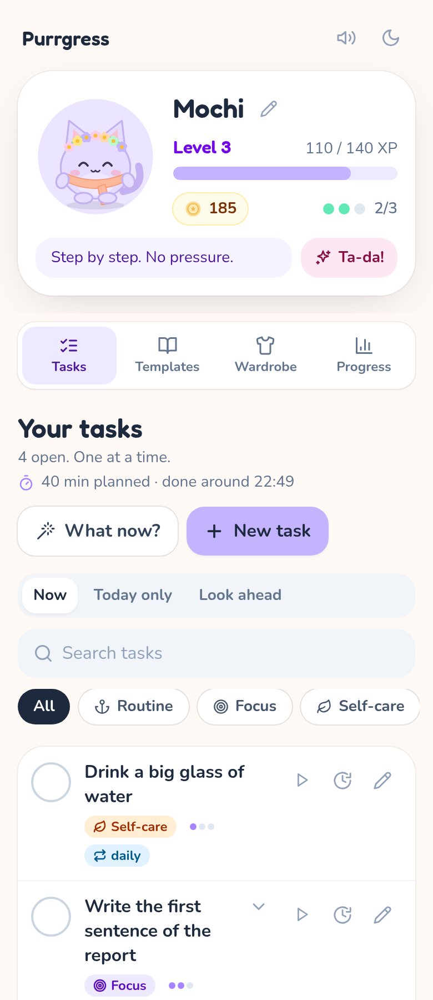
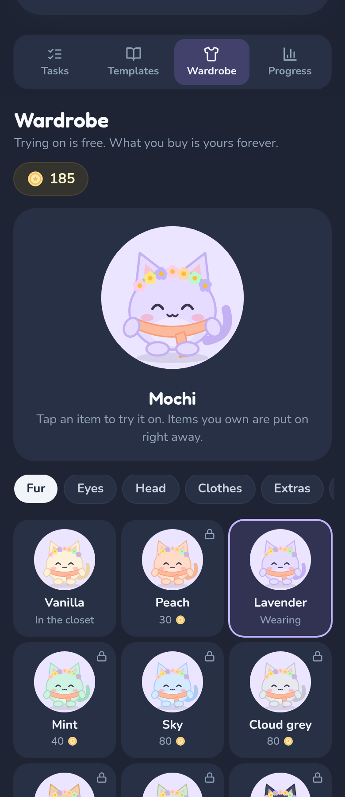

# Purrgress

A neurodivergent-friendly task app with gentle gamification: tick off small tasks, earn XP and coins, dress up Mochi the cat hero, and stay focused with a timebox, without being rushed.

<p align="center">
  
  &nbsp;&nbsp;
  
</p>

## Features

- **Tasks** with category, effort, micro-steps, search and filters
- **Due dates:** no date, today, tomorrow or any other day. Views "Now", "Today only" and "Outlook", with overdue tasks shown gently instead of in red
- **Repeating:** daily or on chosen weekdays. Missed tasks slide forward without leaving copies
- **"Not today"** moves a task to tomorrow with one tap, **"Too big?"** asks for the very smallest first step
- **"Ta-da!":** log things you did that were never planned. They count like any other task
- **Morning check-in** (low energy = only easy suggestions and a smaller daily goal) and **evening wrap-up**, both can be switched off
- **Times of day:** Start of day, Anytime, Wind-down, as collapsible sections that only show up when used
- **Templates** for ADHD, autism, everyday life and wellbeing. One tap and the task is in your list
- **Your own templates:** save any task as a template and reuse it
- **Hero Mochi** with level, stats and a wardrobe: try on for free, buy with coins, milestone items up to level 30 and a few items that only come as surprises
- **Timebox:** start with ▶, pick your own time, ±5 minutes, pause, "Later", allowed overtime, list time with expected finish, reminder chime and brown noise. Mochi works alongside you (body doubling) and learns how long things really take you
- **"What now?"** picks a task for you when deciding is hard
- **Progress:** 7-day history, daily goal, focus time, a streak without punishment. Rest days and cozy blankets (wardrobe) don't break it
- **Little surprises:** at most two a day: found coins, a rare Mochi line or a gift for the wardrobe
- **Introduction:** a short, calm tour on first start, can be switched back on any time in the settings
- **Stays tidy:** finished one-off tasks quietly disappear from the list after 14 days. Progress and history stay
- **German and English:** automatic by device language or fixed in the settings
- **Calm and accessible:** light and dark mode, "Calm animations", keyboard control, screen reader labels
- **Works offline** as an installable PWA
- **Account & sync** through your own server (PocketBase), sign-up by invitation only
- **Backup:** export and import as a file or as text

## Game balance

| Difficulty | XP | Coins |
| --- | --- | --- |
| Easy | 10 | 5 |
| Medium | 25 | 12 |
| Hard | 50 | 25 |

On top of that come +2 XP per micro-step, +20 coins per level-up and once a day +10 coins for reaching the daily goal. From the seventh task of the day on, coins are halved (rounded up) and XP stay full, so the wardrobe lasts a long time even if Purrgress is your only task app. Up to level 10 every level needs 20 XP more than the previous one, after that it gets gradually longer. There are at most two surprises a day. The wardrobe costs 7,510 coins in total. Basic items start at 20 coins, special items unlock at level 5, 8 or 12, and every five levels up to level 30 a milestone item is waiting. At three tasks a day it takes about seven months to buy everything (about three at twelve), yet the first purchase works on day one. Five items can't be bought: Mochi hands them out now and then as a surprise, two of them only rarely.

All values live in `src/constants/game.js` and `src/constants/shop.js`.

## Tech stack

| Area | Tool |
| --- | --- |
| UI | React 19 |
| Build & dev server | Vite 7 |
| Styling | Tailwind CSS 4 (custom values in px) |
| Offline & installation | vite-plugin-pwa (Workbox) |
| Fonts | Fredoka and Nunito, local via Fontsource |
| Tests | Vitest |
| Android app | Capacitor |
| Account & sync | PocketBase (self-hosted, Docker) |
| Code quality | ESLint 9, Prettier |

## Requirements

- Node.js **20.19 or newer** (recommended: 22, see `.nvmrc`)
- npm

## Quick start

```bash
npm install
npm run dev
```

The app now runs at <http://localhost:5173>. Code changes show up in the browser right away.

## Scripts

| Command | Purpose |
| --- | --- |
| `npm run dev` | Development server with hot reload |
| `npm run build` | Production build into `dist/` |
| `npm run preview` | Test the finished build locally (including the PWA) |
| `npm test` | Run the unit tests once |
| `npm run test:watch` | Re-run the tests on every change |
| `npm run lint` | Check the code with ESLint |
| `npm run format` | Format the code with Prettier |
| `npm run dev:phone` | Make the dev server reachable on your Wi-Fi |
| `npm run deploy` | Build and upload to your own server |
| `npm run deploy:server` | Upload the sync server (PocketBase) and restart it |
| `npm run android:add` | Create the Android project (once) |
| `npm run android:icons` | Generate app icon and splash screen for Android |
| `npm run android:apk` | Build the Android APK |
| `npm run android:open` | Open the Android project in Android Studio |

## Project structure

```
purrgress/
├── index.html                 Entry page (Vite)
├── vite.config.js             Vite, Tailwind, PWA manifest, Vitest
├── public/                    Favicon and app icons (web)
├── assets/                    Source images for the Android icon and splash screen
├── docs/DEPLOYMENT.md         Guide: local, server, phone, APK
├── docs/SYNC.md               Guide: sync server, invitations, maintenance
├── scripts/deploy.sh          Build and upload via rsync
├── scripts/deploy-server.sh   Upload the sync server and restart it
├── server/                    PocketBase: Dockerfile, Compose, migrations, invitation hook
├── capacitor.config.json      Settings for the Android app
├── src/
│   ├── main.jsx               Entry point: fonts, CSS, React
│   ├── App.jsx                Top-level component: connects state, hooks and views
│   ├── styles/index.css       Tailwind import, theme tokens, animations
│   ├── constants/             Fixed data without texts: game rules, shop, templates, navigation, timebox
│   ├── i18n/                  Translations: dictionaries (locales/), t(), language choice
│   ├── sync/                  Syncing: API client, three-way merge, flow, storage
│   ├── lib/                   Pure functions without React: tasks, due dates, repeating, energy check-in,
│   │                          rest days, surprises, time sense, levels, timebox, storage, audio
│   ├── hooks/                 Custom React hooks (game state, day change, timebox, sync, color scheme, rewards)
│   ├── components/
│   │   ├── ui/                Reusable building blocks: Icon, Modal, Toast, Toggle, styles
│   │   ├── layout/            Header and tab bar
│   │   ├── avatar/            Mochi as SVG, split into parts
│   │   ├── hero/              Hero card and level-up
│   │   ├── settings/          Data section: backup, import, reset
│   │   ├── sync/              Account section and the choice on first sync
│   │   ├── tasks/             Task row, form, sections, energy check-in, wrap-up, Ta-da, "Too big?"
│   │   ├── tour/              Introduction
│   │   └── timebox/           Time picker, timer ring, mini bar, timer and "What now?" dialogs
│   └── views/                 The four areas: Tasks, Templates, Wardrobe, Progress
└── tests/                     Unit tests for src/lib and syncing, including two-device scenarios
```

## Architecture in brief

- **One state, one source:** The whole game state lives in one object (`useGameState`) and is saved to `localStorage` on every change (key `purrgress-v1`). `migrate()` in `src/lib/state.js` fills in missing fields when older saves are loaded.
- **Logic without React:** Everything that changes the state (ticking off, rewards, timebox) is a pure function in `src/lib/`. These functions take a state and return a new one, which makes them easy to test and independent of the interface.
- **Timebox with timestamps:** The timer stores an end time or the remaining time instead of a running counter. That keeps the time correct after a reload or in the background.
- **Texts separate from code:** Components contain no display texts, only keys like `t('tasks.heading')`. The texts live in `src/i18n/locales/`.
- **Sync without data loss:** Each device remembers its state at the last sync. At the next sync it compares what changed on which side (three-way merge in `src/sync/merge.js`). Counters such as XP and coins are added up, so progress from every device counts.
- **Day change in one place:** `useDailyReset` runs on start, every minute and when you return to the app. It moves repeating tasks forward (`rollRepeatingTasks`), puts cozy blankets over missed days when needed (`protectStreak`) and clears out old finished tasks (`pruneDoneTasks`). All pure functions, so two devices reach the same result independently.
- **Randomness stays outside:** Surprises are rolled once before ticking off (`rollSurprise`) and passed to `completeTask`. That keeps the logic pure and testable.
- **Versioned sync:** The synced state carries a format number (`SYNC_FORMAT` in `src/sync/syncable.js`). If an app meets a newer format, it pauses syncing instead of overwriting something it doesn't know. When you extend the format, raise the number.
- **Hooks for side effects:** Sounds, color scheme, sync and the day change live in their own hooks under `src/hooks/`.

## Translations

The app uses a small translation system of its own without an extra library (`src/i18n/`).

**How a text is used**

```jsx
const { t, duration, clock, day, weekday, repeatLabel } = useI18n();

t('tasks.heading');                        // "Deine Aufgaben" (de) / "Your tasks" (en)
t('hero.title', { name: 'Mochi' });        // placeholders: "Mochi, your hero"
t('tasks.open', { count: 3 });             // plural via zero/one/other
duration(90);                              // "1 Std. 30 Min." (de) / "1 h 30 min" (en)
clock(Date.now());                         // time in the language's format
day('2026-10-30');                         // "Tomorrow", "Friday" or "Mon, Nov 3"
weekday(2);                                // "Di." (de) / "Tue" (en) (0 = Sunday)
repeatLabel(task);                         // "daily" or "Mon, Thu"
```

**Adding a new text:** Add the key to `de.js` **and** `en.js`, then use `t('area.key')` in the code. `npm test` reports when a key or placeholder is missing in one language.

**Adding a new language** (example: Dutch):

1. Copy `src/i18n/locales/en.js` to `nl.js`, name the export `nl` and translate all texts. `meta.name` is the name of the language in itself ("Nederlands"), `meta.locale` e.g. `nl-NL`.
2. Import it in `src/i18n/index.js` and add it to `DICTIONARIES` and `LANGUAGES`.
3. Run `npm test`. The language then shows up in the settings automatically.

Tasks you create yourself are not translated, they belong to the person who wrote them. Templates and starter tasks take the language that is active when they are added.

## Updates and multiple devices

If you use an account, update **all devices** after an update before they sync again. The web app does this by itself the next time it opens, the Android app needs the new APK. From 1.7 on, an outdated app pauses syncing and asks for an update instead of overwriting newer data. What changes in each version is listed in the [CHANGELOG](CHANGELOG.md).

## Usage and deployment

The full guide is in **[docs/DEPLOYMENT.md](docs/DEPLOYMENT.md)**: test locally, publish on your own server with Caddy, install it on your phone as an app and build an Android APK.

In short:

```bash
npm run dev          # test locally
npm run dev:phone    # test on your phone over Wi-Fi
npm run deploy       # build and upload to the server (create .env.deploy first)
npm run android:apk  # build the Android APK (run android:add and android:icons once first)
```

## Data and privacy

Without an account, all data stays in the browser or on the device: no server, no tracking, no ads. Under Progress → Settings → Your data you can download a backup file at any time. With an account, one save per person is also stored on your own PocketBase server (see [docs/SYNC.md](docs/SYNC.md)). Everyone can delete their account and data in the app themselves.

## Security

How Purrgress is protected and how to report a vulnerability is described in [SECURITY.md](SECURITY.md).

## How this was made

Purrgress was designed and directed by Octopuzzled and built largely with AI assistance: the code, tests and documentation were written together with [Claude](https://www.anthropic.com/claude) (by Anthropic) through Claude Code. Ideas, product decisions and testing come from a human. If you find a bug or something that feels off, please open an issue.

## License

Purrgress is licensed under the **[PolyForm Noncommercial License 1.0.0](LICENSE.md)**.

- **Allowed:** using the app, reading the code, adapting it for yourself and, non-commercially, passing it on. The copyright notice from `LICENSE.md` must be kept.
- **Not allowed:** selling Purrgress or versions built on it, building it into a paid product or service, or otherwise making money with it.

For commercial use, please ask first.
